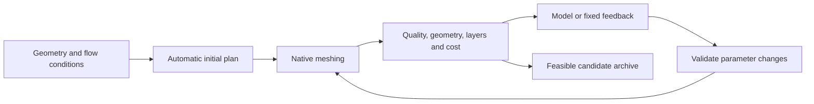

# Attempt_of_Meshing_Agent

An exploration of LLM-guided mesh generation for automotive external flow using OpenFOAM.

[中文说明](README.zh-CN.md) · [Experiment index](docs/EXPERIMENTS.md) · [Implementation](docs/ARCHITECTURE.md) · [Observations](docs/DRIVAER_POSTMORTEM.zh-CN.md)

The research question is whether a language model can use native mesh diagnostics to improve geometry representation, near-wall layers and mesh quality within a fixed cell budget. The workflow couples `deepseek-flash` with measured spatial queries, bounded parameter changes and native execution. OpenFOAM generates the mesh; the model chooses interventions.

## What we observed

The DrivAer study evaluated three original geometries. Its development campaigns recorded 48 native stages, including full generation and separate snapping/layer stages, alongside three programmatic first-output baselines. No candidate met all research acceptance conditions, and a clear advantage over programmatic feedback was not demonstrated.

In the final paired experiment, both routes started from the same automatic parameter seed and performed three additional full mesh generations. The programmatic route applied fixed feedback recipes; the model route selected its own changes. Equal attempt limits did not imply equal cell counts or elapsed time.

|Route|Trial|Cells|Wall area with ≥5 layers|Basic failed checks|Research candidate|
|---|---:|---:|---:|---:|---|
|DeepSeek Flash|1|1,578,685|48.39%|6|Rejected|
|DeepSeek Flash|2|3,933,107|33.63%|0|Rejected|
|DeepSeek Flash|3|1,402,884|30.02%|0|Rejected|
|Programmatic feedback|1|4,195,066|43.25%|6|Rejected|
|Programmatic feedback|2|4,028,341|38.29%|0|Rejected|
|Programmatic feedback|3|4,219,007|43.65%|0|Rejected|

The first model mesh had nonpositive cell volumes; the later model meshes had boundary topology defects. The last programmatic mesh passed the recorded native quality checks, but its boundary fidelity could not be verified by the polygon observer. These are different failure categories.

The programmatic **first output** for this case was 1,361,838 cells with 31.46% five-layer coverage. The larger meshes above belong to programmatic **feedback**, which raised the global refinement level. [Complete final results](results/drivaer_focus_20261012/FINAL_FLASH_113.zh-CN.md), [all-stage evidence](results/drivaer_focus_20261012/FINAL_EVIDENCE.json), and [study interpretation](results/drivaer_focus_20261012/FINAL_CONCLUSION.zh-CN.md) retain the rejected attempts.

The experiments ended in October 2026. The repository records the implementation and the resulting observations; model training, OPD and a reusable successful cross-case policy were not established.


Actual layer fields on the programmatic first-output mesh for case 410, retained as a rejected diagnostic. DrivAerML attribution and figure licensing are in [NOTICE](NOTICE.md).

## Workflow



- Geometry and scenario contracts fix the input, coordinate frame and physical assumptions.
- Spatial queries expose measured defects, nominal sizes, sampled gaps and layer-stack constraints.
- Typed actions adjust refinement, snapping and layer settings; previews screen invalid or redundant changes.
- Stage hashes protect accepted intermediate meshes and support measured restoration.
- Acceptance checks combine native quality, boundary topology, sampled fidelity, scene resolution and actual cell counts.
- API reservations and settled usage share a source-geometry budget across retries and versions.

Failed proposals, programmatic fallbacks and native attempts are recorded separately. Feedback is implemented; successful mesh optimization must be established by the measurements.

## Setup

The native environment uses Linux, Python 3.11 and OpenFOAM v2412. OpenFOAM, MPI and the optional CGAL dependencies are installed separately. The Python package keeps the `cfdmesh` command and module name.

```bash
python -m venv .venv
source .venv/bin/activate
python -m pip install -e .
python -m unittest discover -s tests -v
```

Software tests use fixtures and mocks; they do not request paid model inference or establish native automotive mesh quality.

A single synthetic pipeline run without an API key:

```bash
python -c "import trimesh; trimesh.creation.box(extents=[1,1,1]).export('/absolute/box.stl')"
cfdmesh agent /absolute/box.stl /absolute/new_box_run --advisor none \
  --max-rounds 1 --n-procs 1 --of-root /absolute/openfoam2412
```

See the [usage guide](docs/AGENT_GUIDE.zh-CN.md) and [DrivAer protocol](docs/DRIVAER_FOCUS.zh-CN.md) for the model service, input audit and frozen experiments. The distributed launchers assume Slurm and a shared filesystem; adapt cluster settings before freezing a new protocol. Native runs and model calls have separate resource requirements.

## Repository map

|Directory|Contents|
|---|---|
|`cfdmesh/`|Geometry, planning, model tools, native execution and measurement|
|`scripts/`|Preparation, experiment drivers, reporting and evidence exports|
|`native_tools/`|Optional CGAL audit and wrapping sources|
|`tests/`|Software regression checks|
|`results/drivaer_focus_20261012/`|Focused study, final evidence and measured baseline figures|
|`results/` and `benchmarks/`|Earlier experiments, logs, parameters and comparisons|
|`docs/`|Protocols, implementation notes, analysis and references|

The focused study is the primary evidence. Earlier simplified-shape experiments have different inputs and protocols and remain separately labelled in the [experiment index](docs/EXPERIMENTS.md).

## Scope and data

The studied flow is unbounded, single-phase external flow with fixed direction and first-layer height. Road conditions, moving ground, rotating wheels, converged drag, true flow-derived y+ and grid-independent CFD accuracy were not evaluated. Some boundary polygons fall outside the current fidelity observer's supported representation.

Raw geometry, complete volume meshes, API credentials and provider internal reasoning are not bundled. Sanitized paths are placeholders; archived hashes identify the underlying records. [DrivAerML input provenance](results/drivaer_focus_20261012/input_provenance.json), [data attribution](NOTICE.md), [cost accounting](docs/COST_ACCOUNTING.zh-CN.md) and [snapshot provenance](docs/CODE_PROVENANCE.json) describe the retained evidence.

Code is licensed under GPL-3.0-only. DrivAerML-derived figures retain CC-BY-SA-4.0 attribution separately from the code. OpenFOAM and CGAL are external dependencies. Implementation and experiment organization used an AI coding assistant.
