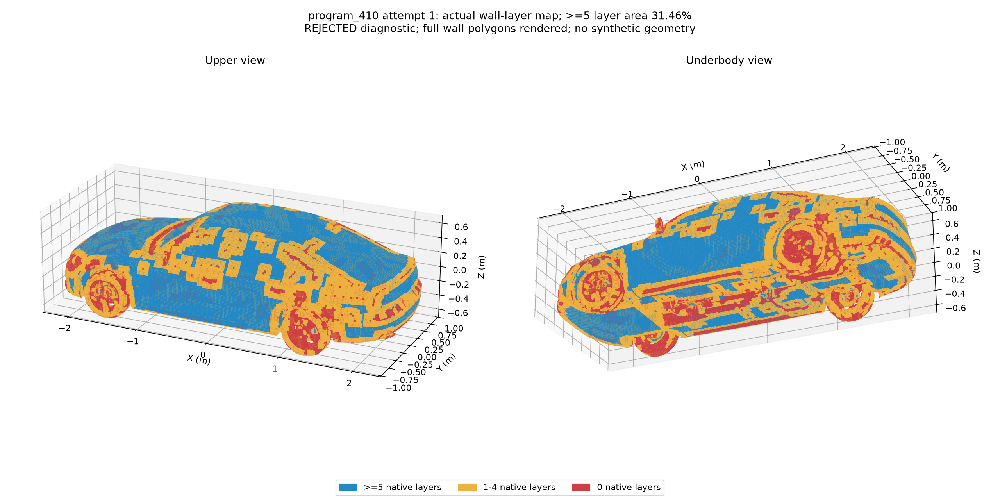

# Attempt_of_Meshing_Agent

A study of model-guided OpenFOAM meshing for **DrivAer car geometries**.

[中文](README.zh-CN.md) · [Protocol](docs/PROTOCOL.md) · [Implementation](docs/ARCHITECTURE.md) · [Failure analysis](docs/FINDINGS.zh-CN.md)

The question is whether `deepseek-flash` can turn measured mesh defects into useful parameter changes while preserving geometric detail, near-wall layers and a bounded cell count. OpenFOAM generates the mesh; the model receives diagnostics and proposes typed interventions.

**The study did not demonstrate a clear advantage over programmatic feedback.** Three original DrivAerML geometries produced no candidate that passed all research acceptance checks. The experiments are closed; this repository records the implementation and the negative results.

## Results

The complete record contains 25 route records and **48 native stages**, plus three programmatic first-output baselines. A stage may be a full generation, snapping, or layer addition; these are not 48 independent cases.

The final paired comparison on case 410 used the same automatic parameter seed and three additional full generations per route:

|Route|Trial|Cells|Wall area with ≥5 layers|Basic failed checks|Research candidate|
|---|---:|---:|---:|---:|---|
|DeepSeek Flash|1|1,578,685|48.39%|6|Rejected|
|DeepSeek Flash|2|3,933,107|33.63%|0|Rejected|
|DeepSeek Flash|3|1,402,884|30.02%|0|Rejected|
|Programmatic feedback|1|4,195,066|43.25%|6|Rejected|
|Programmatic feedback|2|4,028,341|38.29%|0|Rejected|
|Programmatic feedback|3|4,219,007|43.65%|0|Rejected|

The model meshes had nonpositive volumes or boundary topology defects. The last programmatic mesh passed the recorded native quality checks, but the boundary observer could not verify its fidelity. An unsupported projected polygon is not proof of a physical 3D self-intersection.

The programmatic **first output** was 1,361,838 cells with 31.46% five-layer coverage. The larger programmatic meshes in the table came from feedback that raised global refinement. Equal trial limits did not produce equal cell counts or elapsed times.

[All measurements and failures](results/drivaer/evidence.json) · [Results and accounting](results/drivaer/REPORT.zh-CN.md) · [Source provenance](results/drivaer/inputs.json)



Actual wall-layer field, retained as a rejected diagnostic. Figure attribution and licensing: [NOTICE](NOTICE.md).

## Method

1. Audit the unchanged source geometry and freeze the flow conditions and automatic seed.
2. Execute OpenFOAM and measure quality, topology, sampled fidelity, layer fields and actual cell counts.
3. Provide the measurements to the model or apply a fixed programmatic feedback recipe.
4. Validate the proposed parameters, execute within the resource limits, and retain every outcome.
5. Admit only feasible meshes to the candidate archive; compare coverage and cost after feasibility.

The implementation includes spatial queries, parameter previews, protected intermediate mesh copies, a feasible candidate archive, and a shared API ledger keyed by source geometry. Cross-case memory stores measured facts; no successful transferable policy or trained model was established. Defining a reward did not train the fixed API model.

## Install and inspect

Python 3.11 and Linux are used for native execution. OpenFOAM v2412, MPI and the optional CGAL auditor are installed separately.

```bash
python -m venv .venv
source .venv/bin/activate
python -m pip install -e .
python -m unittest discover -s tests -v
python -m scripts.audit_repository
```

These checks use software fixtures and mocked model responses. They do not establish automotive mesh quality or make paid API calls. [Running DrivAer cases](docs/RUNNING.md) documents preparation, protocol freezing and explicit execution. The checked-in evidence describes completed experiments, rather than a downloadable full mesh or an automatic reproduction job.

## Repository

|Path|Contents|
|---|---|
|`cfdmesh/`|Planning, measured model tools, OpenFOAM execution and independent checks|
|`scripts/`|DrivAer preparation, protocol freezing, execution, reporting and publication audit|
|`native_tools/`|Optional CGAL source auditor|
|`tests/`|Software regression checks|
|`results/drivaer/`|Complete stage measurements, input hashes and measured figures|
|`docs/`|Protocol, architecture, execution instructions and failure analysis|

## Limits and licensing

The experiment uses unbounded single-phase flow, +X inflow and +Z up, with a fixed estimated first-layer height. Moving ground, rotating wheels, converged drag, true flow-derived y+ and grid independence were not verified. Results are development observations on three geometries, not an estimate of general industrial success.

Code is GPL-3.0-only. DrivAerML-derived figures retain CC-BY-SA-4.0 attribution. Raw source geometries, full volume meshes and credentials are excluded. [NOTICE](NOTICE.md) separates code, data and external dependencies. Implementation used an AI coding assistant.
