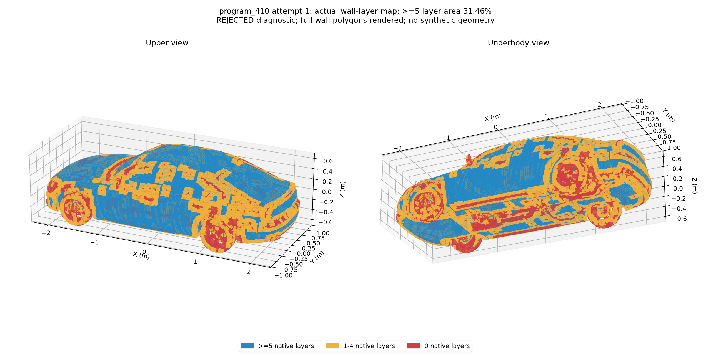

# Attempt_of_Meshing_Agent

探索语言模型能否依据真实网格诊断，在几何、质量与计算资源约束下改善汽车外流网格。

[English](README.md) · [实验索引](docs/EXPERIMENTS.md) · [流程与使用](docs/AGENT_GUIDE.zh-CN.md) · [失败分析](docs/DRIVAER_POSTMORTEM.zh-CN.md)

项目将 `deepseek-flash`、几何测量、结构化干预与 OpenFOAM 原生执行连接成反馈循环。模型选择参数和区域，网格由原生工具生成；质量、拓扑、几何保真、层覆盖与单元数由测量模块检查。

## 研究问题

CheckMesh 通过并不意味着几何细节、近壁层和重要流体区域都得到充分解析。我们尝试回答：在固定输入与资源约束下，模型读取局部证据后的决策，能否优于程序化首次生成和固定程序反馈？

早期实验覆盖若干简化外流形状，随后聚焦 DrivAer 汽车几何。首层物理高度、流向、OpenFOAM 版本和验收规则随协议冻结，失败轮次单独保留。

## 实验观察

DrivAer 研究涉及三个原始车体，开发路线累计记录48个原生阶段，另有三份程序化直出。48包含完整生成和单独的 snap / layers 阶段。没有候选通过完整研究验收，也没有验证出模型相对程序反馈的明显收益。

最后一轮两条路线使用相同自动初始参数，各进行三次新增完整生成：

|路线|轮次|实际单元数|实际至少五层面积|basic Failed|研究候选|
|---|---:|---:|---:|---:|---|
|DeepSeek Flash|1|1,578,685|48.39%|6|不合格|
|DeepSeek Flash|2|3,933,107|33.63%|0|不合格|
|DeepSeek Flash|3|1,402,884|30.02%|0|不合格|
|程序反馈|1|4,195,066|43.25%|6|不合格|
|程序反馈|2|4,028,341|38.29%|0|不合格|
|程序反馈|3|4,219,007|43.65%|0|不合格|

模型第一张存在非正体积，后两张仍有边界拓扑缺陷。程序最后一张通过已记录的原生质量检查，但保真观察器无法可靠处理其中一个多边形，保真未获验证。观察不可用与已证实的质量失败分别报告。

同案例程序化首次直出是1,361,838个单元，至少五层面积31.46%；表中的约400万单元来自提高全局分辨率后的程序反馈。两条路线的单元数与耗时不同。[完整结果](results/drivaer_focus_20261012/FINAL_FLASH_113.zh-CN.md)、[全部阶段证据](results/drivaer_focus_20261012/FINAL_EVIDENCE.json)和[最终解释](results/drivaer_focus_20261012/FINAL_CONCLUSION.zh-CN.md)保留了这些差异。

研究在2026年10月结束。有限参数干预尚未建立可靠的可行网格起点；已实现的工具和保护机制也没有形成经过验证的跨案例优化策略。没有执行 OPD 或模型后训练。



案例410程序化首次生成的层字段，属于未通过验收的诊断网格。DrivAerML 署名与图片许可见[NOTICE](NOTICE.md)。

## 实现

- 几何资格检查、不可变输入与场景条件。
- 原生问题簇、局部尺寸、间隙和层叠测量。
- 结构化细化、吸附与层设置，参数预演与重复方案检测。
- 独立阶段、网格文件哈希保护和可行候选归档。
- 原生质量、边界拓扑、采样保真、场景与资源检查。
- 同一源几何跨重试、版本和路线共用 API 预算；预留与已结算用量分开。

## 使用

原生环境为 Linux、Python 3.11、OpenFOAM v2412及其 MPI 运行时。OpenFOAM 与可选 CGAL 依赖不包含在 Python 包中。Python 命令仍为 `cfdmesh`。

```bash
python -m venv .venv
source .venv/bin/activate
python -m pip install -e .
python -m unittest discover -s tests -v
```

软件测试使用夹具与模拟接口，不调用付费模型。原生执行示例和实验入口见[使用指南](docs/AGENT_GUIDE.zh-CN.md)、[DrivAer 协议](docs/DRIVAER_FOCUS.zh-CN.md)。集群启动脚本依赖 Slurm 与共享文件系统，需要在冻结协议前配置平台参数。

## 阅读与边界

- [研究过程](docs/PROJECT_STORY.zh-CN.md)：问题如何收敛、工具如何变化。
- [架构](docs/ARCHITECTURE.md)：规划、执行、观测与候选保护。
- [实验索引](docs/EXPERIMENTS.md)：当前研究与早期不同协议的结果。
- [失败分析](docs/DRIVAER_POSTMORTEM.zh-CN.md)：日志事实、设计解释和尚未隔离的因素。
- [方法参考](docs/RELATED_MESHING_WORK.zh-CN.md)：不同 Agent 与学习式网格方法的任务边界。

工况为自由空气中的单相外流，没有验证道路、旋转车轮、真实 y+、阻力精度或网格无关性。原始几何、完整体网格、密钥和模型隐藏推理不入库。DrivAerML 输入来源与哈希见[溯源记录](results/drivaer_focus_20261012/input_provenance.json)。

代码采用 GPL-3.0-only；DrivAerML 派生图片另保留 CC-BY-SA-4.0 署名。详见[NOTICE](NOTICE.md)。实现与实验组织使用了 AI 编程助手。
