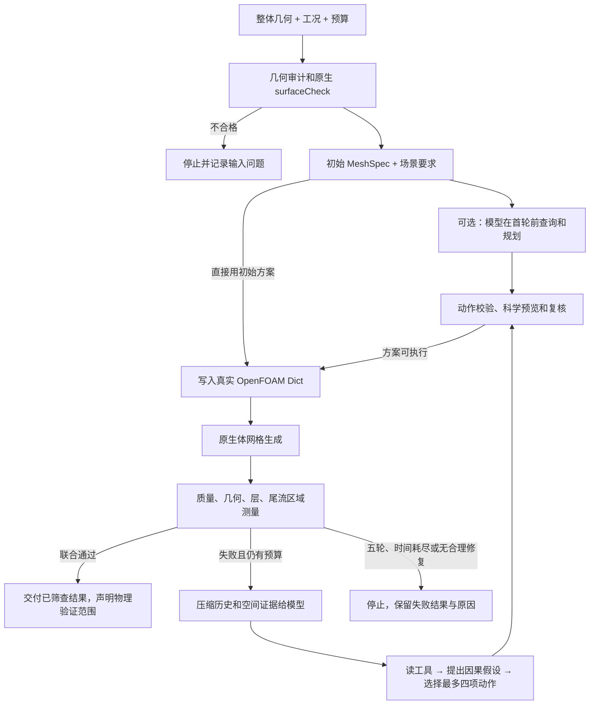

# 从这个 Meshing Agent 理解 Agent：初学者完整指南

本文对应当前 `cfdmesh` 源码，阅读入口是 `agent.run_agent()`。目标是让读者能解释一轮真实任务、找到负责的代码，并区分“模型懂了什么”“程序保证了什么”“实验实际证明了什么”。汽车实验结果另见 `results/drivaer_20261011` 和后续版本报告；本文中的教学动作不冒充实验结果。

## 1. 先建立一个准确的概念

这个 Agent 是一个**带工具、状态、反馈和边界的决策系统**。用户给它一个目标，它读当前证据，选择下一步操作，调用外部工具得到新证据，再决定继续、回退或停止。

把“输入 STL，输出一段建议”交给聊天模型，只有一次语言生成。把“输入 STL，固定跑同一套 Dict”写成脚本，是自动化工作流。我们在工作流里面加入了一个能根据测量选择干预的模型决策环节：例如判断坏单元集中在哪里、细化是否真的能解决问题、是否应改层生长机制、某项干预有没有反证。这部分才是本项目的 Agent 能力。

Agent 不是一个统一的新模型类别，也不要求先训练一个神经网络。此项目使用现成 `deepseek-flash` API，没有对基座模型做微调，没有训练奖励模型，也没有在后台进行强化学习。改进主要发生在 **Harness**：围绕模型设计的输入、工具、运行控制、验证、记录和评测。

Agent 的概念早于大模型：机器人或强化学习策略也可以根据环境观察选择行动。今天讨论的 LLM Agent，是把语言模型放进这个决策闭环。强化学习是学习策略的一种方法；Agent 是系统如何行动的概念，二者不能画等号。这个项目用普通 Python 组织闭环，不依赖必须安装某个 Agent 框架，也没有多个模型主体之间的协作。

| 通用概念 | 白话含义 | 项目中的实体 |
|---|---|---|
| Goal / task | 要完成的目标及约束 | 整体几何的外流场网格、单元上限、最多五轮、RANS 近壁需求 |
| Environment | 真正发生操作和产生结果的外部世界 | 原始几何、OpenFOAM、计算节点、文件系统 |
| Observation | 本次实际能看见的证据 | `quality`、`layers`、`fidelity`、`spatial`、场景测量和图片 |
| Policy / planner | 根据证据选择下一步的方法 | 模型工具对话；也存在确定性初始计划和失败回退 |
| Action space | 被允许的操作集合 | 区域加密、gap 加密、层参数、snap 参数、恢复已测计划等 |
| State | 当前执行进度和可恢复数据 | `MeshSpec`、已执行轮次、候选目录、预算、源文件哈希 |
| Tool | 系统真实执行的函数或程序 | 局部测量工具、Dict 生成器、OpenFOAM 原生程序 |
| Memory | 本任务或跨任务保留的记录 | 本轮历史、`experience.json`；后者仍是待验证观察 |
| Evaluator / verifier | 判断操作是否有效的独立测量 | `evaluate()` 和质量、保真、层、场景检查 |
| Harness | 把以上部分连接起来的工程框架 | `agent.py`、advisor、planning、runner、预算锁与交付记录 |

这些名称便于讨论，不必把 Agent 神秘化。一个可靠的 Agent 往往有大量普通程序；程序负责精确、可重复的事情，模型负责尚不能完全写成规则的选择与解释。

把一轮抽象成 `观察 o_t → 决策 π(目标、观察、历史) → 动作 a_t → 工具执行 → 新观察 o_(t+1)` 就很直观。策略 π 在这里是模型对话加程序约束的组合。评测给出的通过/不通过和指标变化是开发者判断质量的证据，当前没有把它们自动变成神经网络训练信号。

## 2. 从输入到输出的全流程



注意图中有**两种循环**：外层一次循环生成一个真实体网格，最多五次；内层一次科学决策最多四次 API 请求、八次只读查询。OpenFOAM 自身还有数值迭代。模型查询十个指标不等于跑了十轮网格，网格里迭代一百次也不等于 Agent 调了 API 一百次。

下面按一次实际任务的顺序展开。

### 第一步：定义任务，而不是只给形状

入口在 [`cli.py`](../cfdmesh/cli.py)，调用 [`agent.py` 的 `run_agent`](../cfdmesh/agent.py)。输入至少包括几何路径、输出目录、OpenFOAM 路径、单元预算、轮次和工况。

DrivAer 对照使用整体 STL，不读取原始部件名称；约 75.3 万三角面、车长约 4.704 m。采用 +X 来流、+Z 向上、30 m/s、运动黏度 `1.5e-5 m²/s`、目标估计 `y+=50`、1200 万单元上限。本实验采用自由空气中的单相外流场，没有地面、移动地面或旋转车轮。它是复杂车体的网格实验，不能据此宣称真实道路阻力已验证。

为什么需要工况？同一个汽车几何，目标可能是尾流、底部流动或局部压力；同一个机翼，低迎角和大迎角的关键流动区域也不同。几何细节告诉我们“边界在哪里”，科学问题告诉我们“没有边界的流体区域哪里也值得花单元”。

### 第二步：核查输入，建立坐标和身份证

[`geometry.prepare`](../cfdmesh/geometry.py) 读整体几何，检查连接、封闭和法向一致性，计算包围盒、面积、体积，并做面积采样与法向射线查询。随后 `run_agent` 调用原生 `surfaceCheck -checkSelfIntersection`。输入不符合要求会在付费规划前停止。

几何的 SHA256 是文件内容的身份证，用于实验追踪和同源费用累计。可选整体坐标平移会记录可逆变换和变换后的哈希；它不等于删除轮辋、填平凹槽或修复几何。本案例以整个包围盒中心为新原点，保留所有三角面。已证明的刚体变换别名用于合并费用范围；任意重导出的“看起来相同”几何不会自动获得预算重置。

这里已经能看到 Agent 的第一个研究问题：**感知表示**。LLM 不直接逐一读取数百万个面或单元，而是看到采样、局部统计、诊断簇和投影图。压缩决定了它能发现哪些问题，也决定了它会漏掉哪些问题。图片有帮助，但坐标、单位、局部尺度和原生数据更适合做可执行判断。

### 第三步：把任务变成可计算的计划

[`planning.initial_plan`](../cfdmesh/planning.py) 建立初始分辨率、几何区域和层设置。[`scenario.compile_scenario`](../cfdmesh/scenario.py) 建立物理场景要求。目前场景先验由程序编写，例如车辆尾流、机翼相关区域、钝体或浸没体场景；这部分不是模型自行发现了真实流场。

计划以 [`case_builder.MeshSpec`](../cfdmesh/case_builder.py) 保存：背景域、表面层级、距离带、匿名空间盒、feature/snap、层参数、生成质量约束等。模型和程序交换结构化计划，随后统一写成 Dict。这比让模型随意编辑长 Dict 更易比较和验证。

两个尺度很重要：

```python
# planning.py 中 rans_target 的关键计算
re = speed * length / nu
cf = 0.074 / max(re, 1.0) ** 0.2
utau = speed * math.sqrt(cf / 2)
first = 2 * yplus * nu / utau
total = first * (ratio ** layers - 1) / (ratio - 1)
```

`first` 是完整第一层高度；`y+` 通常在第一层单元中心估计，所以存在系数 2。本汽车对照固定初始第一层高度约 `1.295 mm`。这来自平板摩阻关联式，不是已测壁面剪切，更不是全车实际 `y+`。

背景尺寸近似为 `h0=L/base_cells`，细化 level `l` 对应 `h≈h0/2^l`。level 加一会在三维区域中很快增加单元，因此“细节没捕捉到就全局加密”常会浪费预算。层总厚度还要与附近可用流体空间相容；细化切向网格并不会自动增加物理间隙。

### 第四步：模型看到什么，能主动问什么

活动模块是 [`scientific_advisor.py`](../cfdmesh/scientific_advisor.py)，不是历史遗留的 `advisor.py`。`scientific_tools.py` 定义模型能调用的工具：

| 工具 | 给模型的能力 | 不能据此声称的事 |
|---|---|---|
| `query_region` | 在匿名坐标盒里测采样几何、法向、射线间隙和实际层数据 | 不能把有限采样当成全区域严格证明 |
| `inspect_cluster` | 读取一个真实诊断簇的位置、类型及相关测量 | 诊断簇是症状，名称不是已证实原因 |
| `openfoam_reference` | 查当前工具中的参数语义及版本依据 | 当前是精选本地参考，不是任意联网搜索 |
| `inspect_scenario` | 看不可变工况与物理区域要求 | 先验尾流盒不是已求出的尾流 |
| `inspect_plan` | 查已测计划和结果，作为回退依据 | 不合格计划不能变成合格锚点 |
| `preview_actions` | 把完整动作临时应用到计划副本，检查尺度、预算和场景 | 预览不跑网格，其预测不等于实测改善 |
| `propose_mesh_plan` | 最终提交结构化的执行或停止决定 | 函数调用本身不代表动作已经执行 |

**Function calling / tool use** 的实际过程是：程序把工具名、参数 JSON Schema 和用途发给模型；模型返回工具名与参数；程序验证后调用真实 Python 函数；函数结果作为新的 observation 返回模型。模型不会因为写出一句“我查询了”就真的查询。

API 协调器在能联网的节点上运行，测量与网格运行在 Slurm 计算节点上。二者通过共享目录中的 `request_*.json`、`tool_request_*.json`、`tool_response_*.json`、`response_*.json` 通信。一个进程负责调用模型，一个进程负责真实测量，这是部署安排，不是多个不同模型组成的团队。Slurm 资源由外部启动脚本申请，Agent 当前不会自行挑选服务器。

### 第五步：从“可能原因”到一个可检验动作

我们要求模型给出假设、替代解释、反证和预期变化。例如，轮辋附近失层可能来自对向壁面挤压，也可能来自法向突变、snap 后边界夹连、过大的生长比或过短的支持区域。不同原因对应不同操作；单看“coverage 低”不足以决定加密。

下面是**接口教学示例，不是本次模型的真实实验动作**：

```json
{
  "kind": "layer_settings",
  "parameters": {
    "expansion_ratio": 1.1,
    "n_surface_layers": 6
  },
  "why": "测试较薄层栈是否缓解局部挤压；保持第一层高度，复查实际覆盖与坏面",
  "evidence": ["layers"]
}
```

同样可以提出 `gap_refine`：给匿名坐标盒设置 `minimum_cells/start_level/max_level`，由原生 `gapLevel/gapMode outside` 在检测到间隙时触发加密，而不是利用已标注的汽车部件。指定最少间隙单元是目标，受最大层级及预算限制，不保证原生结果一定达到该值。

更好的推理应包含：要解决哪个实际空间问题；哪条测量支持原因；为什么这个参数在当前 OpenFOAM 设置下真的生效；预计哪项量变化；哪些量可能变差。比如 `nGrow` 增加的是邻接**禁挤出区域**，可能降低覆盖；在绝对层高模式下，把 `maxFaceThicknessRatio` 当作首层/面尺寸限制则可能根本没有作用。又如 `layerTerminationAngle/detectExtrusionIsland` 由 medial-axis 收缩器读取，不能拿它们解释 motion-solver 收缩器的改善；检查一个通用层参数文件没找到它们，也不能据此断言整个版本不支持。这些语义陷阱说明知识正确性比“会输出 JSON”更重要。

### 第六步：Harness 审查，模型复核，最后才提交

最终方案经过多层检查：`plan_validation.validate_plan` 检查结构和类型；`planning.normalise_actions` 只做已知字段的无损包装；`planning.apply_actions` 在副本上应用整组操作；`certify` 检查范围、细节分辨率和预算；`mechanisms.intervention_review` 检查空间关联、支持尺度与失效语义；场景筛查确认尾流等要求仍覆盖。

生产对话还要求完整最终预览，并把预览返回模型进行一次科学复核。模型必须区分固体厚度、外向射线间隙、壁距和 OpenFOAM 的流体 medial distance；不能引用旧分辨率去论证偷偷改大的新 `base_cells`，也不能把风险比例没变化说成改善。复核失败，临时方案不会提交到 mesher。

这叫**事务式动作执行**：把一组变化视为一个整体，先在副本上验证，全部通过才变成下一轮计划。程序不会把模型越界的参数偷偷截断成合法值；否则最终执行的就不是模型解释的方案。

边界也会限制模型。它当前不能任意执行 shell、改源几何、降低验收门槛、借预算不足去删除细节或更改来流。因此，这是带约束的决策系统。行动空间不足时，一个正确想法也可能无法表达；这是需要评测的设计取舍，而不是“加上 guardrail 就必然更强”。

### 第七步：真实执行与独立评价

[`case_builder.build_case`](../cfdmesh/case_builder.py) 写 `blockMeshDict`、`surfaceFeatureExtractDict`、`snappyHexMeshDict`、`meshQualityDict` 等。[`runner.run_round`](../cfdmesh/runner.py) 调用真实 OpenFOAM，监控时间、单元量、返回码并保留日志。网格经历背景网格、特征提取、并行细化/贴合/加层、重构和原生检查；实际命令记录在每轮 native steps 中。

STL 只描述物体表面，CFD 求解需要物体外面空气区域的**体单元**。`blockMesh` 先建立包围计算域的背景六面体；`snappyHexMesh` 细化、保留需要的流体区域、把边界贴合表面，再在车体壁面尝试层挤出。`locationInMesh` 是用于选择保留区域的流体种子点，不能误放进封闭车体或空腔。它不是来流速度或坏单元位置。

例如首轮车体设置与下面的 Dict 片段对应。**这里只展示局部字段，不是完整可运行 Dict**；完整执行文件保存在结果目录：

```text
castellatedMeshControls
{
    refinementSurfaces
    {
        body { level (5 5); patchInfo { type wall; } }
    }
}
addLayersControls
{
    relativeSizes false;
    firstLayerThickness 0.00129483932815942;
    expansionRatio 1.2;
    meshShrinker displacementMedialAxis;
    layers { body { nSurfaceLayers 8; } }
}
```

Python 中 `n_surface_layers` 映射到 Dict 中 `nSurfaceLayers`。模型返回计划里的数值，程序负责正确拼写、作用域、单位与兼容的求解设置；原生 OpenFOAM 负责真正计算网格。模型没有“用文字生成了百万个体单元”。

[`agent.evaluate`](../cfdmesh/agent.py) 不是再让模型给自己打分，而是读取独立证据：

| 维度 | 为什么需要 | 主要限制 |
|---|---|---|
| 原生质量 | 非正体积、坏面、偏斜、非正交会损害计算 | 基本 `Failed=0` 还不能替代边界拓扑检查 |
| 边界拓扑 | 共享边、点夹连等不能因平均值漂亮被忽略 | 多边形转三角形观察也可能失败，必须报告不确定性 |
| 几何保真 | 防止“忽略轮辋和凹槽”获得好质量 | 采样距离不是全表面的严格误差界 |
| 层质量 | RANS 近壁区需要合理层数和尺度 | 估算 `y+` 不是实际流场 `y+` |
| 物理区域分辨率 | 尾流等无表面区域也需要单元 | 分辨率通过不证明尾流物理准确 |
| 成本和期限 | 防止不断加密和无限尝试 | 单元预测尚未充分校准，真实计数仍是硬约束 |

层覆盖率用实际壁面面积加权，例如

`C>=5 = Σ(实际层数>=5的壁面面积) / Σ(全部车体壁面面积)`。

≥1 层、≥5 层、达到请求的层数，是三种不同指标。“89% 有一层”不能写成“89% 有合格边界层”。当前严格筛查要求 ≥5 层覆盖 90% 车体面积，未通过会明确标记失败。实际第一层高度由原生总层厚度、层数和给定生长比反推，仍有几何级数假设；估计 `y+` 的验收百分位目前按面数统计，另有面积诊断，两者不能混用。

可选短 SST 求解用于检查数值启动与近壁场，发散时不能拿它调整层高；即使通过，也不等于阻力已收敛、网格独立性成立或实验验证通过。本汽车网格对照不以长期 CFD 求解作为目标。

### 第八步：反馈、回退、停止与交付

失败后的坏面、坏点和失层位置经过空间聚类，构成下一次模型输入。它不会每次重读全部日志和百万单元；至少保留重要指标的代表簇，再选其他簇，并注明省略数量。历史保留各轮动作、真实 Failed 数、覆盖率和原因，避免反复尝试相同方案。

[`candidates.py`](../cfdmesh/candidates.py) 只允许原生质量、几何等基础条件合格的已测计划作为恢复锚点，不能挑一个 coverage 高但有坏单元的网格当合格输出。`restore_plan` 必须先恢复，再加有区别的新干预；完全重复计划不会再消耗一轮。

模型可以显式停止。如果 API 失联、方案非法或没有有效提交，代码可能使用确定性 fallback；结果会标注来源。**因此，“开了模型 API”不等于每个改进动作都是模型决定的。** 做模型贡献分析时要统计真实提交、被拒方案和 fallback 的比例。

最后输出每轮 Dict、日志、证据、计划和图片，以及 `agent_run.json`、`candidate_catalog.json`、`handoff.json`、`experience.json`。`handoff` 明确是否通过以及尚缺哪一级验证；失败结果仍值得保留，不能只导出最好看的图。

## 3. 三种“记忆”和两种“学习”

短期上下文是这次 API 请求中的证据和对话。任务状态是磁盘上的 Spec、轮次、候选和预算；它使程序可追踪，并不意味着模型永远记得上一次会话。跨案例经验是 `experience.py` 保存的成败观察，明确标注 `generalisation='unproven'`。

“同一任务中根据反馈调整”与“改变模型权重”是不同的学习。此项目有前者，没有后者。把一个案例的成功做法加入固定规则也不是训练；只有在独立几何族、留出案例和反例测试后，才适合把它写成有适用条件的 Harness 经验。否则提示词会越来越长，模型越来越擅长复述训练案例，却没有更好的泛化。

当前 `openfoam_reference` 属于精选知识工具，没有向量数据库，也没有完整 RAG 管线。RAG 是按当前问题检索外部资料再辅助生成的一类方法；未来可用于按 OpenFOAM 版本检索参数源码，但检索结果仍要核对上下文和执行语义。[RAG 原始论文](https://arxiv.org/abs/2005.11401)

## 4. 用本项目认识 Agent 研究中的几个核心问题

**推理与行动交替。** 模型提出一个假设，查询真实量，再修正动作，与 ReAct 讨论的 reasoning/action 交替有相似之处。我们是工程实现，不是完整复现该论文，也不靠公开私有思维链证明效果；工具调用、结构化假设与原生结果更可审核。[ReAct 原始论文](https://arxiv.org/abs/2210.03629)

**部分可观测与主动感知。** “整个网格”是环境的实际状态，模型只看到某个压缩观察。模型既要选操作，也要选接下来测哪块区域。可以用“部分可观测决策”理解这个困难；此代码没有实现一个正式 POMDP 求解器。

**计划与控制。** 一次性计划容易忽略未知缺陷，反馈控制能纠偏；但错误观察可能诱导错误动作，五轮限制又要求优先解决高风险问题。最多四项并行动作是费用与信息效率的折中，也会使“到底是哪项动作导致改善”更难判断。

**工具表达能力。** 匿名空间盒增强了空间操作，原生 gap 动作增强了间隙处理；只有全局调参的 Agent 可能知道应处理轮辋，却没有表达办法。相反，工具越多，选择和组合难度越大。需要测任务成功率，不能用工具数量衡量水平。

**验证器与规格漏洞。** 模型可能优化容易看的 coverage 而牺牲拓扑。如果只看 Failed 数，又可能遗漏点夹连。严格验证器能阻止伪成功，但自己的解析器、三角化和近似预测也可能错误拒绝好方案。因此 verifier 也需要原生对照和边界案例测试。

**评测和因果归因。** Agent 研究的难点常在多步交互和可靠执行，而不仅是静态问答。AgentBench 提供了多种交互环境的评测视角，本项目应构建自己的工程评测，不能拿通用榜单代替工业网格实测。[AgentBench 原始论文](https://arxiv.org/abs/2308.03688)

**成本与上下文管理。** 输入 token、输出 token、缓存命中、调用次数和真实余额变化是不同量。程序先按输入/输出上界预留费用，成功后按 provider usage 结算预算；缓存已知时应使用缓存价格，未知请求保留预留。`usage.json` 的美元预算上限不是平台人民币实付账单。同源案例跨目录累计，不能靠新建目录隐性增加授权费用。[DeepSeek 价格](https://api-docs.deepseek.com/zh-cn/quick_start/pricing/)

## 5. 怎样判断这个 Agent 真有价值

建议在固定输入、工况、质量门槛和资源上限下比较：同一初始方案只跑一轮；相同确定性反馈策略；模型加几何工具；模型再加科学工具与复核。既报告原始数值，也报告达到联合验收的成功率、实际单元数、网格时间、API 费用和失败原因。

要分别回答三件事：反馈是否比首轮好；新 Harness 是否比旧 Harness 好；模型是否比相同程序化策略增加收益。这三个命题不是一回事。一次新汽车案例好转只能支持这个案例的证据；多种未见真实几何才更接近泛化证明。单元数不同、层数不同、部分指标口径不同，都必须明确。

DrivAer 旧对照就是一个反例：旧 Agent 最好 ≥5 层覆盖约 35.45%，直接 Codex 一路最高约 57.00%，但两路都没有通过全部验收。Fluent 的“超过 80%”只有外部描述，没有相同面积口径、层数、首层高度和单元数，不能构成同口径胜负。当前改进是否有效，必须看新版本原生网格结果；一个合成间隙工具测试通过，不足以证明汽车已经修好。


## 6. 建议的代码阅读与动手顺序

1. 读 `cli.main → agent.run_agent → agent.evaluate`，只追踪一轮，不一开始钻全部 Dict。
2. 读 `MeshSpec`，把一个真实 `roundN/record.json` 的 `spec` 对照实际 `system/snappyHexMeshDict`。
3. 读 `scientific_tools.TOOLS/plan_tool` 和 `scientific_dialogue`，看一次 request、真实 tool call、response 与最后执行动作。
4. 读 `planning.apply_actions/certify`，尝试一个非法计划，观察为什么在运行前拒绝。
5. 读 `verify.layer_report` 和 `quality_report`，手算一小块表面 coverage，理解指标口径。
6. 最后读 `candidates/experience/handoff`，区分临时候选、待验证经验与合格交付。

可先跑无需 API 的单元检查 `python -m unittest discover -s tests`，再用安装好的 OpenFOAM 做一个小型原生 smoke。需要实际 Agent 时，在计算节点运行 `python -m cfdmesh.cli agent ...`，同时在能联网的环境启动 `serve-advisor`，私钥用独立文件传入，不写进仓库。`--advisor none` 不启动模型；`--model-plan` 才让模型在首轮网格之前参与规划。没有该参数时，首轮可以是程序或显式方案，模型从真实失败后的反馈开始参与。

当前模型接口实现还有一个具体限制：查询阶段开启模型 thinking，最终为了使用接口支持的命名工具提交，会关闭 thinking，并进行预览后的复核。一次查询阶段如果只生成很长推理、没有完成工具调用，后面的格式阶段不等于自动继承了一个有效计划。因此要评测实际工具轨迹与网格结果，不能把推理 token 更多当作能力更强。

读完后，你应该能具体解释：模型本轮看见什么、询问什么、提出什么、哪些动作被拒绝、真实执行了什么、结果是否支持原假设、为什么停止。能回答这些问题，已经比只会把聊天 API 包成一个“Agent”更接近扎实的 Agent 工程与研究。
