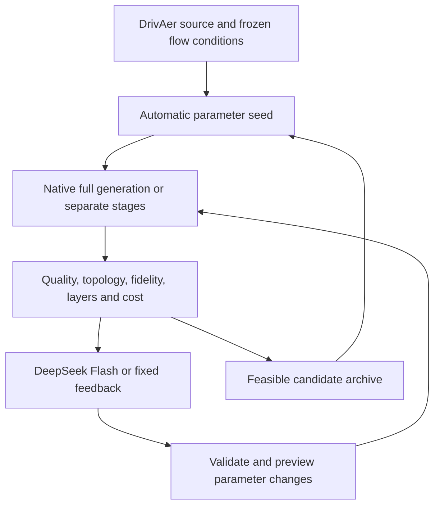

# Implementation

The DrivAer research entry point is [run_drivaer](../cfdmesh/drivaer.py). It operates on a frozen source and scenario, executes bounded native trials, and keeps diagnosis, decisions and acceptance separate.

## Data flow

## Responsibilities

|Component|Responsibility|
|---|---|
|`geometry`, `surface_contract`|Unchanged source identity, coordinate conditioning and input audits|
|`planning`, `case_builder`, `scenario`|Automatic specification, typed parameters and flow-resolution hypotheses|
|`runner`, `stages`|OpenFOAM execution, limits, independent stage copies and source-hash checks|
|`verify`, `boundary`, `layer_design`|Native quality, boundary observation, actual layer area and thickness diagnostics|
|`scientific_tools`, `plan_validation`, `mechanisms`|Measured queries, parameter semantics and intervention previews|
|`scientific_advisor`, `budget_scope`|Model dialogue, commitment and same-source cost accounting|
|`drivaer`, `candidates`|Research eligibility, trial history and feasible archive|
|`cross_case`|Measured facts from disjoint source groups; no promoted successful policy|

## Decisions and measurements

The model can inspect geometry, quality clusters, local sizes and sampled gaps, consult parameter semantics, and preview an intervention. Actions adjust refinement, snapping, layer controls and transition settings. It does not generate arbitrary executable code or alter acceptance thresholds.

A preview checks syntax, bounds, supported mechanisms, spatial references, cost estimates and repeated or ineffective actions. It cannot predict that OpenFOAM will produce a valid mesh. A successful model commitment remains a proposal until native execution and independent checks supply the result.

Model proposals, normalized actions, fixed recipes, software fallbacks and actual native stages have separate records. Protected snap anchors require accepted evidence and matching specification/source hashes. Layer construction uses independent mesh-file copies; changes to snap construction invalidate the anchor. Failed high-coverage meshes never enter the feasible archive.

## Evidence boundary

`agent_run.json` and per-stage records in a live experiment contain executable specifications and detailed measurements. The checked-in [evidence](../results/drivaer/evidence.json) is a compact collection from completed records: it preserves metrics, rejection reasons, timings, usage ceilings and original-record hashes. It omits source geometry, complete volume meshes, provider private reasoning and environment-specific paths.

[The evidence manifest](../results/drivaer/manifest.json) hashes the published measurement collection, inputs and figures. Software checks and the repository audit verify implementation contracts and publication integrity. They do not validate native automotive performance.
