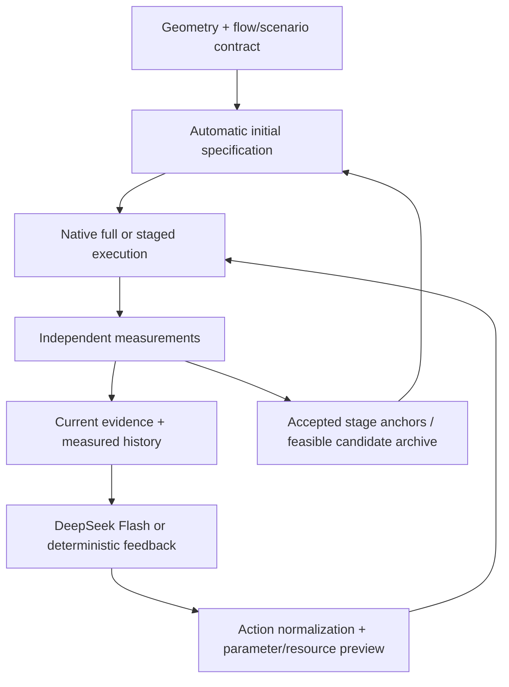

# Implementation

The Python module and CLI are named `cfdmesh`. OpenFOAM v2412 is the native backend; the model service selects structured interventions rather than generating the final mesh itself.

## Data flow

The generic runner is in `agent.py`; focused staged/full DrivAer experiments are in `drivaer.py`. Failed proposals, fallback actions and native executions carry separate attribution.

## Modules

|Area|Files and responsibility|
|---|---|
|Geometry and scene|`geometry.py`, `scenario.py`: immutable source auditing, sampled geometry and compiled flow conditions|
|Specification|`case_builder.py`: typed mesh parameters and native dictionaries|
|Planning|`planning.py`, `mechanisms.py`, `targets.py`: action application, numeric/physical screens and measured target resolution|
|Model interface|`scientific_advisor.py`, `scientific_tools.py`: query/preview/commit dialogue, receipts and reservations|
|Execution|`runner.py`, `stages.py`: native subprocesses, stage registration and hash-protected mesh copies|
|Measurement|`verify.py`, `boundary.py`, `layer_design.py`: quality, topology, polygon geometry and actual layer-area statistics|
|History|`candidates.py`, `cross_case.py`, `decision_checkpoint.py`: measured candidates, source-separated facts and visible decision checkpoints|
|Resource planning|`resource_model.py`: same-source measured cost calibration; an estimate rather than a guaranteed bound|

## Protected stages and feedback

An accepted snap can be reused for a layer-only trial through an independent file copy. Changes affecting snap invalidate that anchor. Full-mode trials rebuild from the current executable specification.

After failure, a new plan starts from the best feasible full candidate, a safe snap anchor, or the common initial parameters. In the final DrivAer study no feasible candidate existed, so new proposals returned to the initial parameters while retaining diagnostic history.

## Acceptance and observations

Quality, boundary topology, geometry fidelity, scene coverage and actual cell counts determine research eligibility. Coverage ranks eligible candidates; it does not override quality failures. Older production-layer thresholds remain separate from the focused research comparison.

The boundary observer has representation limits for warped or projected self-crossing polygons. Missing fidelity evidence is recorded as unavailable. Actual layer thickness is distinct from requested layers and from flow-derived y+.

## Model state and cost

Tool responses contain measured values and stated uncertainty. Parameter validity and mechanism checks do not predict native success. Model internal reasoning is not part of the published evidence.

Budget reservations and documented usage share the original source group across experiment directories. Cross-case memory records facts; it does not automatically train weights or promote a successful policy.

See [DrivAer protocol](DRIVAER_FOCUS.zh-CN.md), [experiment index](EXPERIMENTS.md) and [failure analysis](DRIVAER_POSTMORTEM.zh-CN.md) for execution evidence and limitations.
