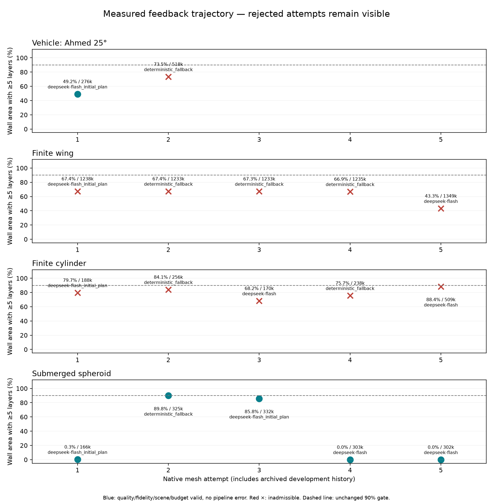
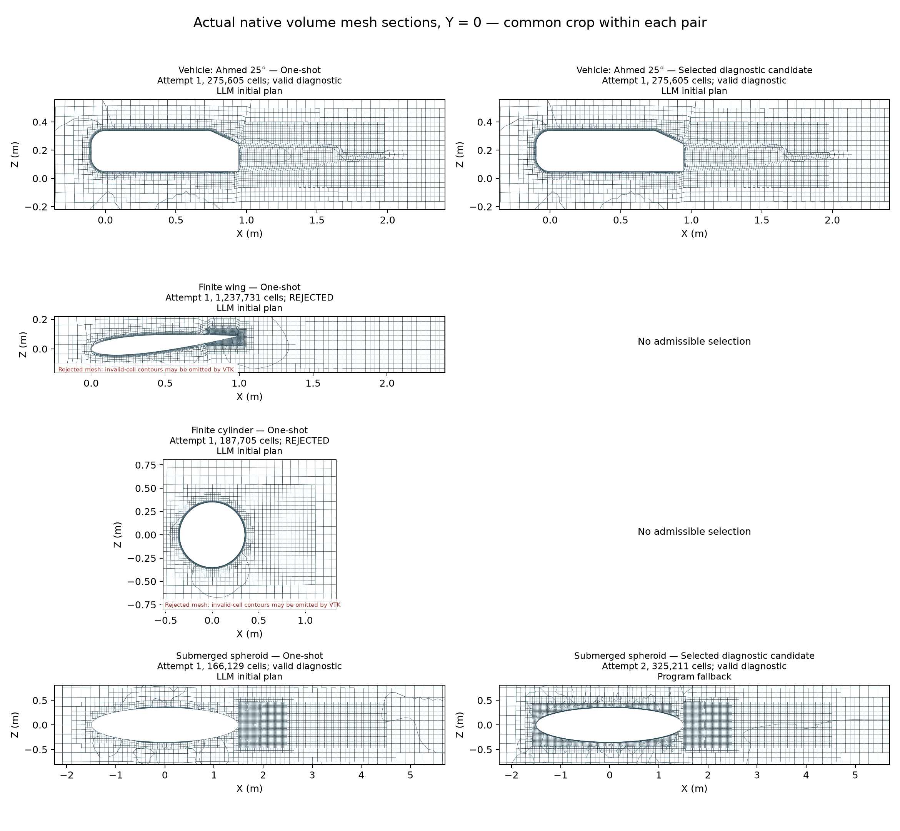
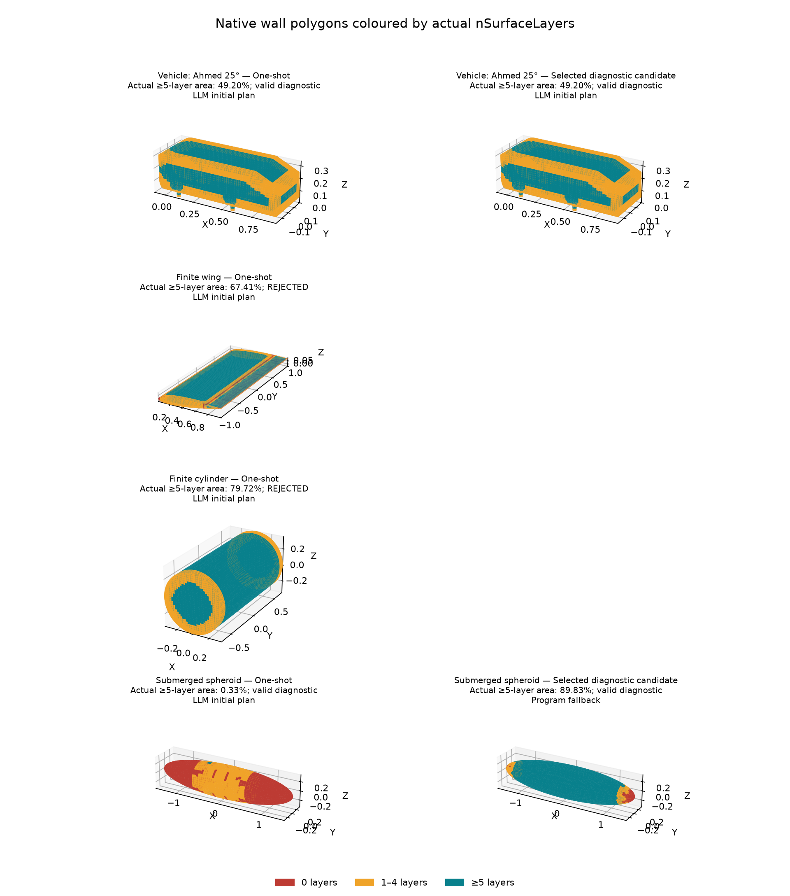

# Earlier external-flow experiments

The [independent new-version DrivAer episode](../results/drivaer_v9_20261012/REPORT.zh-CN.md) completed another bounded five-attempt feedback experiment with the same legacy initial-spec control. >=5-layer area rose33.77%→41.38%, but the maximum had negative volumes and six basic failed checks; all three critical regional boxes were below the old Agent maximum. All five were rejected. Post-episode0.9.1 software fixes and112 passing tests are not mesh-performance evidence.

The [real whole-body DrivAer comparison](../results/drivaer_20261011/REPORT.zh-CN.md) adds ten rejected native meshes: frozen Agent maximum ≥5-layer coverage35.45% (2.79M cells), direct Codex57.00% (5.01M). Neither passed all gates; cell counts and action spaces differ. The [0.9 native gap integration](../results/mechanisms_20261012/README.md) is a separate synthetic tool check, not an industrial Agent result.

[Separate archived vehicle proposal validation](RESULTS_APPENDIX.md) · [Scientific-prior ablation](SCIENCE_ABLATION.md) · [Failure analysis](FAILURE_ANALYSIS.zh-CN.md) · [Resource accounting](COST_ACCOUNTING.zh-CN.md)

The baseline is the identical first mesh of each episode, including the same initial scientific planning. The feedback workflow gets additional attempts, not equal total compute. No geometry-only straw-man control is used.

Four development shapes; no statistical or held-out industrial success rate. Vehicle and spheroid include archived V6 attempts and a frozen-core continuation; the two other shapes have new closed-loop episodes. All attempts and code hashes are retained.

| Case | One-shot cells / ≥5-layer area | Selected cells / ≥5-layer area | Gain (pp) | Attempts | Selected origin | Joint / screened handoff |
|---|---:|---:|---:|---:|---|---|
| ahmed_public_25 | 275,605 / 49.20% | 275,605 / 49.20% | +0.00 | 2 | deepseek-flash_initial_plan | False / False |
| finite_wing | 1,237,731 / 67.41% | no admissible measured selection | — | 5 | none | False / False |
| finite_cylinder | 187,705 / 79.72% | no admissible measured selection | — | 5 | none | False / False |
| submerged_spheroid | 166,129 / 0.33% | 325,211 / 89.83% | +89.49 | 5 | deterministic_fallback | False / False |

Selection was fixed before execution: only native-quality, geometry, scene and budget valid meshes without native pipeline errors qualify; maximise actual ≥5-layer area, then minimise cells. Selecting an earlier candidate is allowed. Rejected attempts cannot win by having high coverage.

Rejected meshes can contain non-manifold cells which VTK cannot contour. Their cut panels are incomplete diagnostics, explicitly labelled; no rejected mesh is selected because of its appearance.

## ahmed_public_25

Stop: repeated plan blocked without spending another meshing round

New API peak-price upper bound: $0.043925; same-source cumulative: $0.194303. New wall time: 85.4s. Counts include unusable answers; no internal model reasoning is exported.

| Attempt | Phase / decision | Cells | ≥5 layers | Q / geometry / scene | Native error |
|---|---|---:|---:|---|---|
| 1 | historical_development / deepseek-flash_initial_plan | 275605.0 | 49.20% | True / True / True | none |
| 2 | historical_development / deterministic_fallback | 517720.0 | 73.52% | False / True / True | observed boundary native self-intersection evidence failed/unavailable |

Joint-gate failure reasons for every attempt:

- Attempt 1: less than 90% body area has at least 5 actual layers
- Attempt 2: native checkMesh failed checks: 3; unknown failures are never ignored; max_non_ortho exceeds RANS quality limit 70; less than 90% body area has at least 5 actual layers; observed boundary native self-intersection evidence failed/unavailable

## finite_wing

Stop: five-round or requested round budget exhausted

New API peak-price upper bound: $0.214661; same-source cumulative: $0.214661. New wall time: 2432.0s. Counts include unusable answers; no internal model reasoning is exported.

| Attempt | Phase / decision | Cells | ≥5 layers | Q / geometry / scene | Native error |
|---|---|---:|---:|---|---|
| 1 | frozen_portfolio / deepseek-flash_initial_plan | 1237731.0 | 67.41% | False / True / True | observed boundary native self-intersection evidence failed/unavailable |
| 2 | frozen_portfolio / deterministic_fallback | 1233407.0 | 67.41% | False / True / True | observed boundary native self-intersection evidence failed/unavailable |
| 3 | frozen_portfolio / deterministic_fallback | 1233357.0 | 67.29% | False / True / True | observed boundary native self-intersection evidence failed/unavailable |
| 4 | frozen_portfolio / deterministic_fallback | 1235287.0 | 66.91% | False / True / True | observed boundary native self-intersection evidence failed/unavailable |
| 5 | frozen_portfolio / deepseek-flash | 1348538.0 | 43.25% | False / True / True | observed boundary native self-intersection evidence failed/unavailable |

Joint-gate failure reasons for every attempt:

- Attempt 1: native checkMesh failed checks: 6; unknown failures are never ignored; max_non_ortho exceeds RANS quality limit 70; max_skew exceeds RANS quality limit 4; max_aspect exceeds RANS quality limit 1000; nonpositive cell volume; less than 90% body area has at least 5 actual layers; observed boundary native self-intersection evidence failed/unavailable
- Attempt 2: native checkMesh failed checks: 6; unknown failures are never ignored; max_non_ortho exceeds RANS quality limit 70; max_skew exceeds RANS quality limit 4; max_aspect exceeds RANS quality limit 1000; nonpositive cell volume; less than 90% body area has at least 5 actual layers; observed boundary native self-intersection evidence failed/unavailable
- Attempt 3: native checkMesh failed checks: 6; unknown failures are never ignored; max_non_ortho exceeds RANS quality limit 70; max_skew exceeds RANS quality limit 4; max_aspect exceeds RANS quality limit 1000; nonpositive cell volume; less than 90% body area has at least 5 actual layers; observed boundary native self-intersection evidence failed/unavailable
- Attempt 4: native checkMesh failed checks: 6; unknown failures are never ignored; max_non_ortho exceeds RANS quality limit 70; max_skew exceeds RANS quality limit 4; max_aspect exceeds RANS quality limit 1000; nonpositive cell volume; less than 90% body area has at least 5 actual layers; observed boundary native self-intersection evidence failed/unavailable
- Attempt 5: native checkMesh failed checks: 1; unknown failures are never ignored; max_non_ortho exceeds RANS quality limit 70; less than 90% body area has at least 5 actual layers; observed boundary native self-intersection evidence failed/unavailable

## finite_cylinder

Stop: five-round or requested round budget exhausted

New API peak-price upper bound: $0.161455; same-source cumulative: $0.161455. New wall time: 1254.4s. Counts include unusable answers; no internal model reasoning is exported.

| Attempt | Phase / decision | Cells | ≥5 layers | Q / geometry / scene | Native error |
|---|---|---:|---:|---|---|
| 1 | frozen_portfolio / deepseek-flash_initial_plan | 187705.0 | 79.72% | True / True / True | observed boundary native self-intersection evidence failed/unavailable |
| 2 | frozen_portfolio / deterministic_fallback | 256254.0 | 84.08% | True / True / True | observed boundary native self-intersection evidence failed/unavailable |
| 3 | frozen_portfolio / deepseek-flash | 169930.0 | 68.24% | True / True / True | observed boundary native self-intersection evidence failed/unavailable |
| 4 | frozen_portfolio / deterministic_fallback | 237824.0 | 75.65% | True / True / True | observed boundary native self-intersection evidence failed/unavailable |
| 5 | frozen_portfolio / deepseek-flash | 508942.0 | 88.37% | True / True / True | observed boundary native self-intersection evidence failed/unavailable |

Joint-gate failure reasons for every attempt:

- Attempt 1: less than 90% body area has at least 5 actual layers; observed boundary native self-intersection evidence failed/unavailable
- Attempt 2: less than 90% body area has at least 5 actual layers; observed boundary native self-intersection evidence failed/unavailable
- Attempt 3: less than 90% body area has at least 5 actual layers; observed boundary native self-intersection evidence failed/unavailable
- Attempt 4: less than 90% body area has at least 5 actual layers; observed boundary native self-intersection evidence failed/unavailable
- Attempt 5: less than 90% body area has at least 5 actual layers; observed boundary native self-intersection evidence failed/unavailable

## submerged_spheroid

Stop: five-round or requested round budget exhausted

New API peak-price upper bound: $0.085445; same-source cumulative: $0.217300. New wall time: 838.5s. Counts include unusable answers; no internal model reasoning is exported.

| Attempt | Phase / decision | Cells | ≥5 layers | Q / geometry / scene | Native error |
|---|---|---:|---:|---|---|
| 1 | historical_development / deepseek-flash_initial_plan | 166129.0 | 0.33% | True / True / True | none |
| 2 | historical_development / deterministic_fallback | 325211.0 | 89.83% | True / True / True | none |
| 3 | frozen_portfolio / deepseek-flash_initial_plan | 332314.0 | 85.82% | True / True / True | none |
| 4 | frozen_portfolio / deepseek-flash | 302664.0 | 0.00% | True / True / True | none |
| 5 | frozen_portfolio / deepseek-flash | 302417.0 | 0.00% | True / True / True | none |

Joint-gate failure reasons for every attempt:

- Attempt 1: less than 90% body area has at least 5 actual layers
- Attempt 2: less than 90% body area has at least 5 actual layers
- Attempt 3: less than 90% body area has at least 5 actual layers
- Attempt 4: less than 90% body area has at least 5 actual layers; actual layer thickness unavailable
- Attempt 5: less than 90% body area has at least 5 actual layers; actual layer thickness unavailable

## Interpretation limits

Unbounded single-phase +X flow/+Z up. No road ground, free surface, production-car/aircraft qualification, converged force accuracy, or mesh-independence proof.

Layer coverage is measured from the native final field and weighted by wall area. Pre-solver y+ remains a flat-plate/stack inference. A short SST probe is not force convergence or grid-independence validation. Named wake/tip boxes are physical hypotheses, not measured vortex trajectories.

Geometry-only versus science-prior ablations from V6 are documented separately; their changes are deterministic-prior effects and cannot establish LLM or feedback gains.
