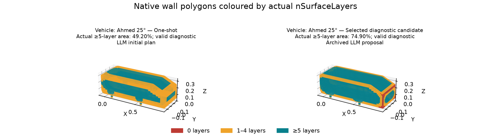
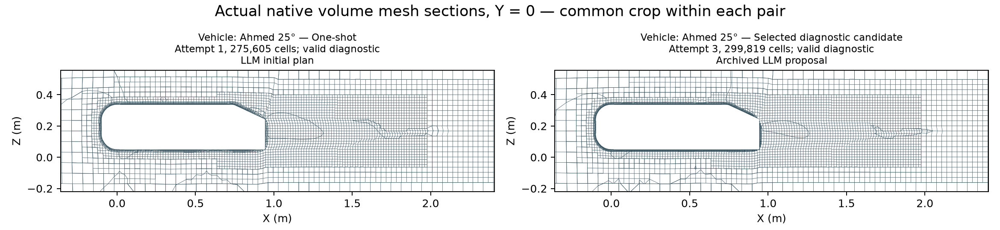

# Separate vehicle proposal validation

This follow-up was added after the main online vehicle plan failed its interface. It is not merged into the frozen main comparison. The earlier certified model proposal was executed without parameter edits and without another API call. Remaining source-wide native attempts were then available to an online follow-up.

| Attempt | Origin | Cells | Actual ≥5-layer area | Q / geometry / scene |
|---|---|---:|---:|---|
| 1 | deepseek-flash_initial_plan | 275605.0 | 49.20% | True / True / True |
| 2 | deterministic_fallback | 517720.0 | 73.52% | False / True / True |
| 3 | archived_model_proposal_validation | 299819.0 | 74.90% | True / True / True |

Selected admissible diagnostic candidate: attempt 3, coverage 49.20% → 74.90% (+25.70 percentage points), cells 275,605 → 299,819 (+8.79%).

Selected joint acceptance: False. Outstanding reasons: less than 90% body area has at least 5 actual layers; estimated y+ distribution outside wall-function target 30..300.

Same-source API peak-price upper bound, including earlier development and the failed main plan: $0.194303. Total native attempts across all related phases: 3 (cap five).

A wall-coverage gain is not a demonstration of correct y+, sufficient outer-layer thickness or converged RANS accuracy. The complete outstanding gates remain visible. This targeted validation does not replace a frozen held-out benchmark.

## All failure reasons

- Attempt 1: less than 90% body area has at least 5 actual layers
- Attempt 2: native checkMesh failed checks: 3; unknown failures are never ignored; max_non_ortho exceeds RANS quality limit 70; less than 90% body area has at least 5 actual layers; observed boundary native self-intersection evidence failed/unavailable
- Attempt 3: less than 90% body area has at least 5 actual layers; estimated y+ distribution outside wall-function target 30..300
