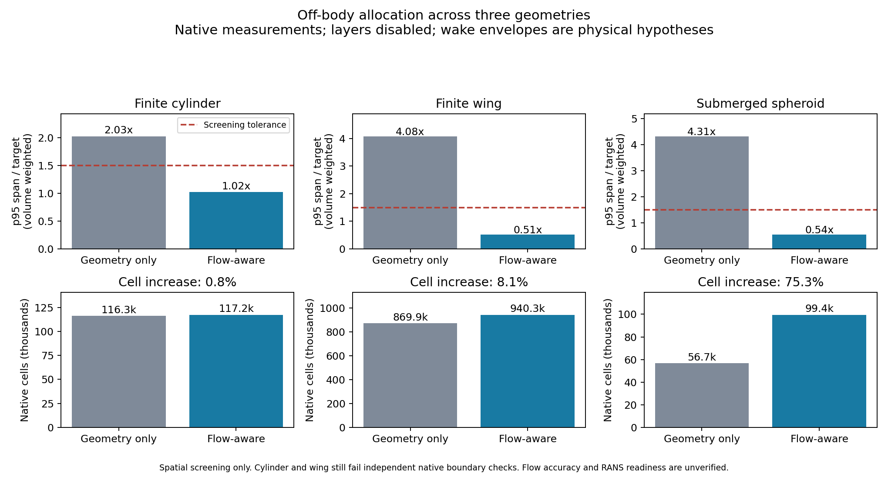

# Separate ablation: geometric versus scientific off-body allocation

These archived V6 experiments isolate a different question from the feedback benchmark: whether scene-aware off-body refinement resolves required regions more effectively than geometric-distance refinement alone.

Three pairs used the same whole geometry, background/surface/snap/distance-shell settings and 2,000,000-cell cap. Layers were disabled to isolate off-body allocation. The added boxes were generated by deterministic scenario priors, not the LLM.

| Probe | Cells: geometric → scientific | Near-wake / lifting-wake native volume-weighted p95 cell span (m) | Scientific scene screen |
|---|---:|---:|---|
| Finite cylinder | 116,283 → 117,242 | 0.17723 → 0.08925 | Passed |
| Finite wing | 869,926 → 940,304 | 0.25385 → 0.03173 | Passed, including tip corridors |
| Submerged spheroid | 56,727 → 99,420 | 0.37742 → 0.04743 | Passed |

All geometric baselines failed the added scene screen. Measurements use actual native volume cells, centre-in-region selection, whole-cell volume weighting and a 4×4×4 occupancy check. The final read-only audit matched reader cell counts to CheckMesh without changing polyMesh hashes.

All six passed basic CheckMesh and sampled fidelity. Cylinder and wing pairs also failed the generated-body native self-intersection check, so they are **diagnostic evidence of regional resolution improvement**, not valid overall mesh successes. Only the spheroid pair passed the complete configured no-layer mesh gates. No RANS handoff or solution-accuracy result is claimed.

This supports including scientific context beyond surface distance. It does not establish feedback gains, autonomous LLM discovery of flow structures, or a physically correct wake envelope. Main feedback results are kept separate in [RESULTS.md](RESULTS.md).

