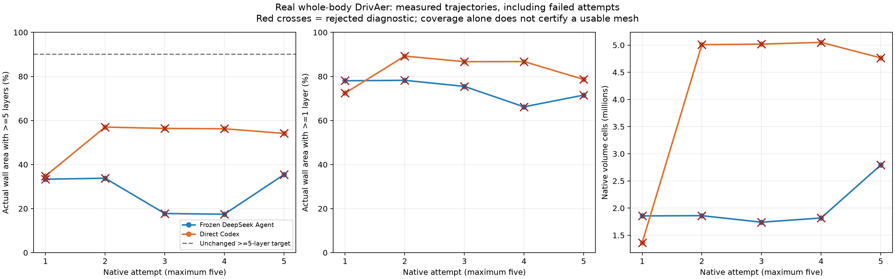
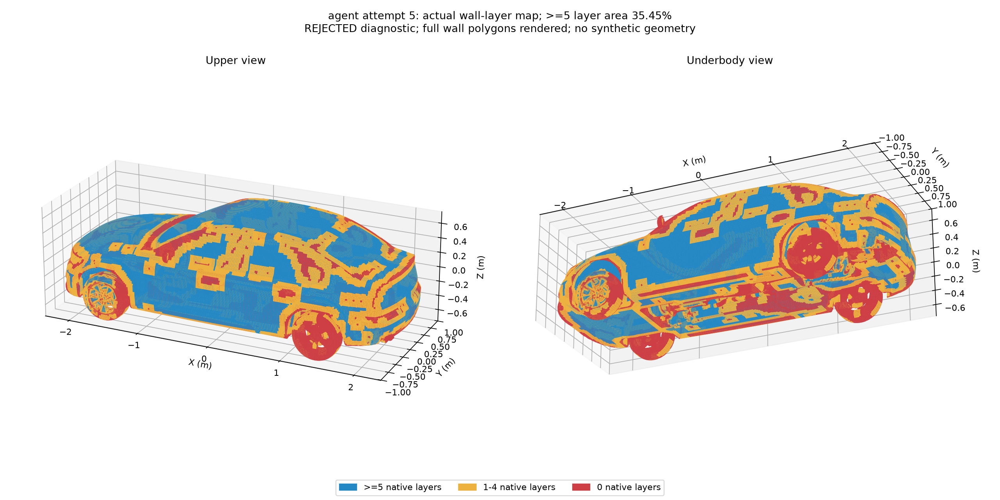
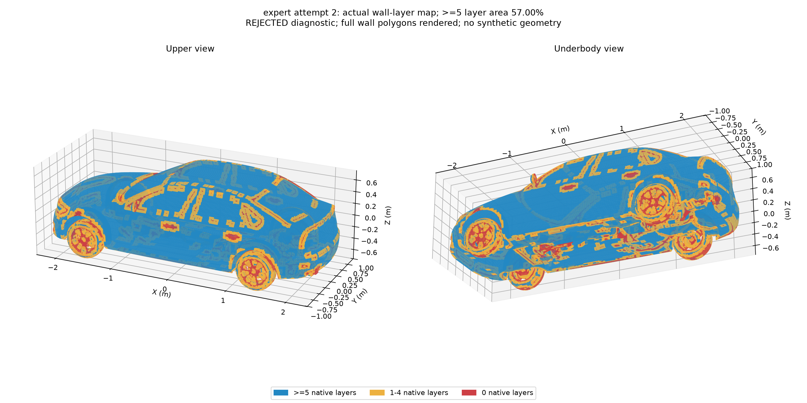

# 真实整体 DrivAer：五轮网格对照与失败诊断

实验日期：2026-10-11。结论：**当前 Agent 未达到这个复杂工程案例的可用门槛；直接 Codex 路线也没有产出通过完整验收的网格。** 两路各完成五次原生网格生成，未追加第六轮。下文最高覆盖率对应的网格均被拒绝，仅用于诊断。

## 输入与可比工况

输入为实验输入的 `drivaer_1.stl`，753,234 三角面、376,531 合并顶点，尺寸约 4.704 × 2.021 × 1.515 m。原始 SHA256：`411e6651284a26fc94924106b833fd79febc6deba63922c929dd8acfc99720d2`。输入检查为一个连接、封闭、水密、绕向一致的整体；所有三角面保留，所有 solid/部件名称剥离，不使用预先分好的车轮、底盘等语义部件。按尺寸推断为米，采用车头位于负 X、来流 +X、向上 +Z 的明确假设。

原始坐标下 native surfaceCheck 报告一处相邻近共面三角面的交叉。预先统一进行整个物体的 bbox-centre 刚体平移后，native 检查通过，逆变换最大误差 4.44×10⁻¹⁶ m。未补洞、删除面、焊接轮辋或改变形状。该数值敏感性不能被解读为已数学证明原始交叉是假阳性。平移后两路输入完全一致，输入审计不计作 snappy 轮次。新版入口亦在原始文件上独立验证了同一可逆流程。

共用 OpenFOAM v2412、32 MPI 进程、每轮 1800 秒、每路 10800 秒、最多五轮、1200 万单元上限。速度 30 m/s，ν=1.5×10⁻⁵ m²/s；第一层完整物理高度固定 0.001294839328 m，初始要求 8 层、增长率 1.2。使用**自由外流工况，没有道路地面、移动地面或轮胎旋转**；这是整体车形网格对比，不是已验证的道路汽车气动仿真。

科学场景约束包含车尾近尾流（后缘至一倍车长）和远尾流（一至三倍车长）的分辨率与占据要求，基于实际体单元中心、体积测量。它体现来流和尾流先验，尚不能证明阻力或涡结构精度。没有运行长时间 CFD、没有真实壁面 y⁺或网格独立性结论。

原有验收门槛未改：基本原生质量与完整车体边界拓扑、几何保真、单元预算、尾流代理、层质量均需通过；≥5 层覆盖须达到实际车体壁面面积的 90%。几何保真采用双向采样、体积/面积与局部细节误差。第一高度相关式给出的 y⁺只是代理，不是真实求解值。

## 全部十轮结果

覆盖率按**实际生成的 body 壁面面积**统计，≥1 层和≥5 层分开。面积加权值不等于按面数统计的百分比，也不等于“任意地方出现层网格”。requested layer 数发生变化时，≥5 的统一定义保持不变。

| 路线 | 轮次 | 单元数 | ≥1 层面积 | ≥5 层面积 | 要求层数 | 基本 Failed | 完整验收 |
|---|---:|---:|---:|---:|---:|---:|---|
| 冻结 Agent | 1 | 1,856,448 | 78.04% | 33.34% | 8 | 1 | 未通过 |
| 冻结 Agent | 2 | 1,860,879 | 78.23% | 33.79% | 8 | 1 | 未通过 |
| 冻结 Agent | 3 | 1,740,247 | 75.49% | 17.77% | 6 | 0 | 未通过 |
| 冻结 Agent | 4 | 1,817,609 | 66.20% | 17.45% | 5 | 1 | 未通过 |
| 冻结 Agent | 5 | 2,792,621 | 71.52% | 35.45% | 5 | 1 | 未通过 |
| 直接 Codex | 1 | 1,364,170 | 72.43% | 34.82% | 8 | 1 | 未通过 |
| 直接 Codex | 2 | 5,008,311 | 89.24% | 57.00% | 6 | 1 | 未通过 |
| 直接 Codex | 3 | 5,018,984 | 86.71% | 56.40% | 6 | 0 | 未通过 |
| 直接 Codex | 4 | 5,050,411 | 86.75% | 56.24% | 6 | 1 | 未通过 |
| 直接 Codex | 5 | 4,765,239 | 78.66% | 54.14% | 5 | 1 | 未通过 |

冻结 Agent 的最好 ≥5 覆盖为 **35.45%（第5轮，279万单元）**；直接路线为 **57.00%（第2轮，501万单元）**，相差21.55个百分点。但直接路线该轮用了约1.79倍单元，两路动作空间也不完全相同；这不是匹配单元数的纯模型能力实验。不得单独归因于 DeepSeek 与 Codex 的基座差异。直接路线由当前 Codex 会话规划，本实验未独立鉴定服务后台的精确模型版本。

Agent 对自己的无反馈首轮：≥5 从33.34%到35.45%，仅增加2.11个百分点，单元数增加约50%；≥1 则从78.04%降至71.52%。**本案例未证明 Agent 有显著且合格的反馈增益**。直接路线相对自身首轮增加22.18个百分点，但单元数约3.67倍，且网格仍不合格。最终第5轮不是覆盖最高的一轮，所有轮次都保留，未挑选不合格网格包装为成功。

Fluent 的“覆盖80%以上”是实验输入的外部参考，没有网格、面积定义、层数、第一高度和单元数。**不能画同口径排名、不能声称优于或劣于 Fluent**。尤其不能将直接路线的89.24%“≥1层面积”拿去冒充达到80%的工业层质量。

## 真实网格形态

蓝色为≥5层，黄色为1–4层，红色为0层。两张图均使用完整原生车体壁面多边形，没有用合成车形替代，也没有为了视觉效果丢弃复杂部位。光滑车身已有较多连续层，轮辋、底盘与细小凹槽失层严重。

实际体网格重要截面：[Agent第5轮](figures/agent_round4_cuts.png)、[直接路线第2轮](figures/expert_round1_cuts.png)、[直接路线最后一轮](figures/expert_round4_cuts.png)。这些图由真实 polyMesh 读取并核对单元数及文件哈希。**VTK 可能无法绘出畸形多面体的部分截线；图像不能认证拓扑，也不能作为完整切面单元统计。**

## 失败由什么造成

1. **工程几何的层挤出与边界拓扑是主瓶颈。** Agent 第3轮和直接第3轮的 basic Failed 为0，却分别有不连通的边界点面扇、共享边的非流形车体边界。其他轮次亦有局部质量坏面或边界缺陷。CheckMesh 汇总的“0 Failed”不等于车体是可投入求解的闭合流形边界。
2. **原有几何观测器过于受限，但不能据此把失败全部归咎于观测器。** 它拒绝过度翘曲或无法验证星形分割的原生面，导致几何保真未认证。新版支持合法简单凹多边形的保面积耳切分割；对现有网格重新测量仍发现过度翘曲、投影自交或原始边连接不闭合。全部十轮又以 stock surfaceMeshExtract 三角化独立复查，仍未得到通过完整几何认证的候选。比如直接第2轮原始 polygon 边连接闭合，但 stock 三角表示报告227非法三角形、730交叉位置；这证明该表示不能认证保真，**不证明原始多边形有730处物理自交**。详见 checks 的独立记录和原始质量日志。
3. **两次“反馈轮”实际上是回退策略。** Agent 第2轮因模型同轮提交两个最终计划而立即拒绝；第4轮因局部 band 的物理约束失败而在对话后拒绝。原 Harness 未把精确错误交还模型修正，就用确定性回退消耗了宝贵网格轮次。因此五轮结果不能描述为五次都由 LLM 科学决策。
4. **模型的参数解释含有科学错误。** 例如6层、增长率1.15、相同第一高度的完整厚度约11.33 mm，模型曾描述为6.7 mm；它也混淆 medial 厚度限制与 featureAngle 抑制挤出的作用方向。公开计划中的“为什么”是待检验假设，不是实验事实。第3轮还同时关闭显式与隐式特征 snap，≥5 覆盖跌至17.77%；这是可疑干预，未通过消融证明单一原因。
5. **冻结动作空间不足且质量生成阈值不一致。** 直接路线使用了面分裂、避免对角线、层终止角、extrusion island 等原 Harness 无法表达的原生控制；冻结默认生成边界 skewness 允许20，最终验收要求4。新版已开放受约束的控制并统一默认生成门槛。不能把工具能力差异藏在“模型对比”里。
6. **局部加密不是万能修复。** 直接第2轮全局level6与局部level8改善了覆盖，却留下一个不良面分解四面体；第3轮改善 basic 质量却产生共享边缺陷；第5轮缩短层厚、增加面质量裕度并加密问题位置，最终仍有9个插值权重坏面、2个twist坏面、2个determinant坏面和2条共享边。需要处理贴合、面分裂、层终止与间隙分辨率的耦合，不能不停增加level。

在直接第2轮的只读质量诊断中，将原生 minTriangleTwist 设为0.01，检测到219个违反该条件的面。这是单独的诊断，未修改原网格，未改变冻结验收结果，也未消耗新 snappy 轮次。其语义是面内相邻三角法向一致性，不是体积或边界流形的替代检查。

## 已经完成的重建与验证边界

V8 候选在独立分支实现：整体可逆坐标入口；按原始 SHA 归一的跨版本费用账本；原生边界警告与非流形点位置解析；简单凹 polygon 的忠实观测；面分裂/层终止等类型化动作；只能收紧生成质量、不能降低最终验收门槛的动作；最终计划嵌套 schema 检查；预演整个动作束并把实际错误返还模型；保留一次纠错机会；明确数值边界与精简纠错上下文。

**93项测试通过**，包含非法动作拒绝、物理 band、原生边界警告、点集坐标、合法凹多边形体积面积、预算跨平移与版本共享、最终计划修正与原文件不变性；真实75万面入口经原生 surfaceCheck 通过。它们证明软件控制和测量改进，并不证明新的工业网格质量。

v8_preview：未得到通过预演的计划，final proposal schema invalid；v8_preview_v3：未得到通过预演的计划，URLError。第一次实际测试仍提交 min_face_weight=0.02，低于允许的0.05，被校验器拒绝。随后把纠错反馈改为明确的允许范围及精简上下文，离线测试通过；最后一次在线审计遭遇 DNS 解析故障（Name or service not known），没有得到最终计划，因而未验证这次修补的在线效果。

所有新版在线测试均使用第5轮缓存测量，native_attempts=0，原始五个 polyMesh 文件与历史记录哈希未变。冻结 Agent 16次 API 调用的价格上界估算为$0.2529957；连同新版只读规划审计，原始同一几何累计费用上界 **$0.3917115**，上限$0.50。该值包括 DNS 失败请求保守保留的$0.0520977额度，不代表该失败请求实际被计费。当前 Codex 会话费用未测量，这不是两模型费用公平性实验。估算不是平台账单。没有给版本或平移后的文件重新发$0.50额度。

**新版没有第六轮 DrivAer 网格，也没有“修复成功”的原生结果。** 静态计划预演只保证动作语法、尺度和策略约束，不保证 snappy 产生合格网格。

## 实际 Dict 与复现记录

这里保存的是每次实际执行的完整 system Dict，而非事后重新生成的建议模板：

- [Agent覆盖最高：第5轮 snappyHexMeshDict](dicts/agent/attempt5/system/snappyHexMeshDict)
- [直接路线覆盖最高：第2轮 snappyHexMeshDict](dicts/expert/attempt2/system/snappyHexMeshDict)
- [直接路线最后：第5轮 snappyHexMeshDict](dicts/expert/attempt5/system/snappyHexMeshDict)
- 两路十轮的 blockMeshDict、meshQualityDict、decomposeParDict、特征提取及求解器配置均在 dicts 下；全部基本/扩展 native 日志在 checks 下。
- [固定协议](protocol.json)、[简明逐轮数据](summary.json)、[动作、spec与独立复查](attempts.json)、[新版只读计划](v8_plan_only.json)、[费用](budget.json)、[文件校验清单](SHA256SUMS.json)。

Dict 坐标属于共同平移后的局部坐标系；恢复原始位置需加回 (1.586642, 0, 0.4377345) m。完整 meshes 留在 原生执行环境 的独立实验目录；本交付不包含用户 STL 或大体积网格。输入许可未确认，发布代码与这些审计记录不意味着可以重新发布该 STL。

## 项目判断和下一步

该对照没有得到通过完整验收的汽车网格。两条路线的单元数和动作范围不同，不能把单例差异单独归因于基座模型。

后续按以下优先级推进，先用小几何或新留出案例验证，再设计新的公开基准，不能暗中超用本次五轮：

1. **先打通可信 native 边界观测。** 保存原始面 ID、点、边与失败单元关联，区分几何失真、三角表示失败和真实拓扑破坏。用合法翘曲/凹面及受控非流形案例校准，不通过渲染补洞来“修复”数据。
2. **补齐流体间隙与局部层机制工具。** 开放经版本核查的 gapLevel/gapMode、局部层停止与面分裂，并验证关闭 feature snap 时控制是否有效；从失败空间聚类确定干预范围。gap 工具尚未在 V8 实现，不能算已完成成果。
3. **让模型提交可检验的科学干预。** 每次含失败位置、机制、反证、数值量纲、变化预测与退出条件；使用工具计算层厚、流体间隙/medial尺度，防止 solid 半厚度替代流体距离。错误参数先在便宜预演内修正，再花一个网格轮次。
4. **重新做因果可比较的评估。** 增加匿名真实车体、机翼或船体留出案例；至少比较无反馈、确定性反馈、模型反馈，固定单元预算层级、首层物理高度和动作空间。同时报告几何/拓扑/层数厚度、尾流代理、时间和费用；只有完整合格候选才能比较求解表现。Fluent 有实测文件和统一定义后再加入排名。

## 原生控制的参考

- [OpenFOAM snapping 说明](https://doc.openfoam.com/2306/tools/pre-processing/mesh/generation/snappyhexmesh/snapping/)：nFaceSplitInterval 与对角线处理可能改善面分割及层挤出，但不能保证成功。
- [OpenFOAM 层终止与 extrusion island 控制](https://www.openfoam.com/news/main-news/openfoam-v3.0/meshing)。
- [OpenFOAM snappyHexMesh 质量参数说明](https://www.openfoam.com/documentation/user-guide/4-mesh-generation-and-conversion/4.4-mesh-generation-with-the-snappyhexmesh-utility)。这里的 Fluent-compatible 参数说明不提供 Fluent 覆盖率证据。
