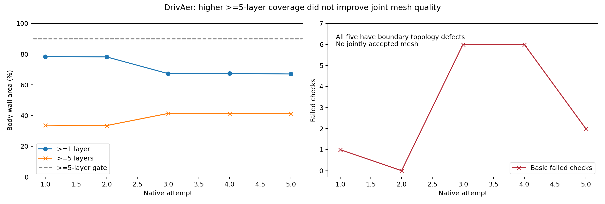
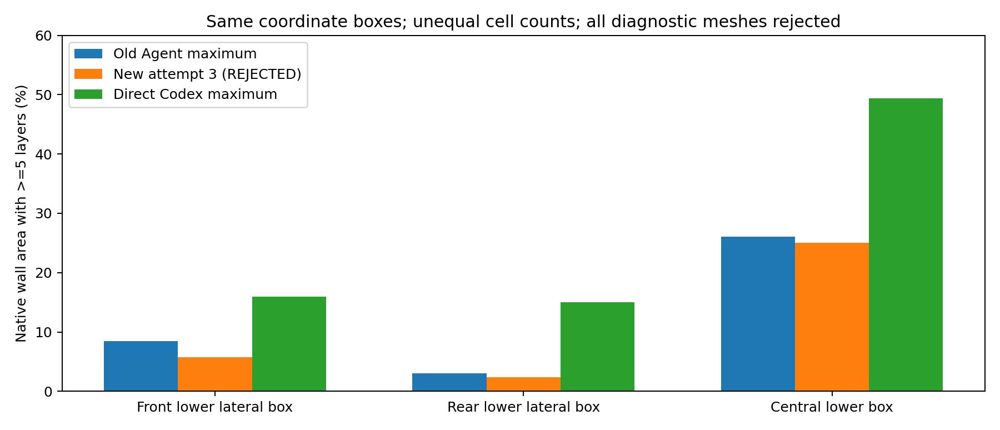
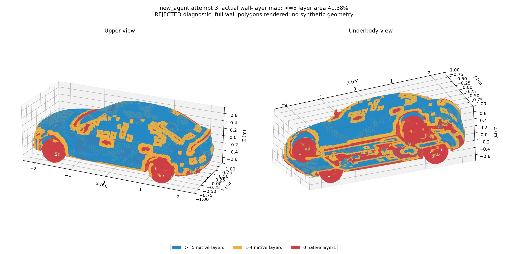
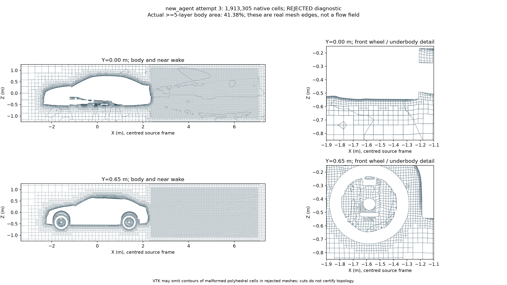

# DrivAer 新版反馈实验：覆盖局部增加，联合质量没有改善

2026-10-12 在32核计算节点实际运行完整五轮。**没有合格候选，不应投入CFD生产求解。** 全局 ≥5 层面积最大值从本轮首轮33.77%升至41.38%，但该轮出现负体积、6项基本Failed和共享边缺陷。前后原生单元数仅增加约2.84%，这不是网格合格性的替代证据。

## 对照范围

同一原始整体DrivAer，753,234三角面，来源SHA256 `411e6651284a26fc94924106b833fd79febc6deba63922c929dd8acfc99720d2`；不使用已有部件标签。整体中心平移，+X来流30m/s，nu=1.5e-5，第一层高度固定约1.295mm；自由空气单相，无道路地面/轮胎转动，12M单元上限，32MPI，最多5轮。本轮约89.8分钟完成，未运行长期CFD，实际y+和力精度未知。

**为了比较反馈，首轮复用旧Agent的初始MeshSpec**，修正与实际一致的check_min_face_weight元数据，并由新版writer写出已知默认控制。它是同初始化的闭环实验，不能替代发行版全部新默认配置的验收。旧两路各五轮完全冻结；本轮是独立的新版本episode，不是原实验的第六轮。预算仍按同源跨版本累计。

执行核心hash `6de092a2251a170670c0678df0cdcb485d5d1aebb6bef4f9f5531c007d574792`。后续0.9.1的收缩器适用条件、分阶段token预留、DNS和时段计费修正在独立软件测试中验证，**没有插入本轮运行，也没有重新划出第六个网格来替换失败结果**。模型输出上限在两次已完成决策后的空闲点由8192→32768→16384调整，变化见[记录](advisor_config_change.json)；没有人工修改下一轮Dict。该开发性调整也意味着这不是严格冻结的模型模式消融。

## 全部五轮

|轮次|实际单元|≥1层面积|≥5层面积|基本Failed|最大非正交|最大偏斜|最小体积m³|动作来源|
|---|---:|---:|---:|---:|---:|---:|---:|---|
|1|1,860,450|78.41%|33.77%|1|64.95°|4.18|2.417e-09|初始方案|
|2|1,859,476|78.18%|33.47%|0|64.98°|3.89|2.417e-09|程序回退|
|3|1,913,305|67.30%|41.38%|6|164.16°|17.96|-5.743e-09|模型有效提交|
|4|1,912,444|67.39%|41.20%|6|164.17°|19.82|-5.744e-09|程序回退|
|5|1,911,171|67.07%|41.30%|2|75.01°|19.82|2.427e-10|程序回退|

第1轮有边界点夹连，其余四轮有共享边问题。第2轮基本Failed=0仍不合格。第3、4轮存在负体积且最大aspect报告约1.97e95，是严重退化，不能因为层覆盖更高而挑选交付。第5轮恢复正体积，仍有最大非正交75.01°、偏斜19.82和共享边，未解决关键问题。几何保真因原生边界异常无法认证，不能把“无法认证”改写为几何通过。

只有第3轮来自完成工具查询、合法提交和科学复核的模型方案：4次查询后改变分批加层和平滑、启用特征面分裂等，并保留尾流要求。多项变量同时改变，不能把变化归因于某个单参数。其余反馈轮均为明确标记的程序回退。

首次对话耗尽推理输出与格式纠正机会，最终预览来得太晚，未完成科学复核。第3轮后的模型修复在4次API请求后仍提交max_boundary_skewness=15，超出允许[0.5,4]而被拒绝。第4轮后的对话完成8次查询，但保守费用预留阻断了后续提交，最终采用回退。**大量回退和单一有效模型干预，说明实际模型自主规划远少于“调用了13次API”给人的印象。**

## 关键空间区域没有变好

同一中心坐标系中的固定匿名诊断盒，选壁面面中心落入盒内的完整多边形面积加权；前/后下方侧盒另要求abs(Y)≥0.6。它们覆盖轮辋、轮拱与邻近车身的混合区域，**不是已有部件标签，也不是精确零件分割**。盒坐标、面积、面数及全部五轮数值见[comparison.json](comparison.json)。

|区域|旧Agent最高全局覆盖轮|新第3轮最高全局覆盖|直接Codex最高覆盖轮|
|---|---:|---:|---:|
|Front lower lateral box|8.49%|5.71%|15.91%|
|Rear lower lateral box|3.07%|2.35%|15.05%|
|Central lower box|26.10%|25.02%|49.41%|

相对于旧Agent最高覆盖轮，三个关键诊断盒的 ≥5 层比例都降低。与本轮首轮相比，前侧盒仅5.44%→5.71%，后侧盒4.45%→2.35%，中央下方21.32%→25.02%；前、后侧盒 ≥1 层比例分别48.97%→17.04%、51.76%→13.37%。**全局增加主要不能解释为难部位已经修好。**

旧Agent全局最大35.45%（2.79M），新最大41.38%（1.91M），直接Codex最大57.00%（5.01M）。实际单元数和动作空间不同，不能单凭此表排名基座模型。三路都没有联合合格网格。Fluent的80%以上仍只有外部口述，不是同口径对照数据。

## 真实形态与Dict

蓝色≥5层，黄色1—4层，红色无层。图中轮辋、底盘、凹槽仍显著缺层；图像来自实际壁面多边形与原生nSurfaceLayers，不是生成插图。

[首轮层图](figures/new_agent_round0_layers.png)和[首轮体网格截面](figures/new_agent_round0_cuts.png)保留。渲染核对原生单元数、五个polyMesh核心文件哈希和全局覆盖；VTK可能省略无法切割的畸形单元，因此图不能认证拓扑。切面表示真实网格边，不表示流场或流线。

完整执行文件：[首轮snappyHexMeshDict](dicts/attempt1/snappyHexMeshDict)、[模型第3轮snappyHexMeshDict](dicts/attempt3/snappyHexMeshDict)、[最后一轮snappyHexMeshDict](dicts/attempt5/snappyHexMeshDict)。其余Dict和每轮原生检查在dicts/checks；公开日志只替换私有账户路径，原始日志hash及渲染核对记录在comparison.json。

## 费用与结论

本轮13次API成功请求：预算当时按缓存后的美元高峰上限记录$0.139375044；后验确认全部在同一空闲时段后，官方美元价表对应$0.069687522，人民币用量估算￥0.46458348。该用量核算不代表供应商逐笔账单。保留[当时预算记录](usage.json)与[带证据的时段纠正记录](usage_reconciled.json)，没有回写原实验的费用阻断决定。[预算核算说明](../../docs/COST_ACCOUNTING.zh-CN.md)

**明确结论：这次增强提高了观测、参数语义审查和实验可追溯性，也提高了一项全局层指标；它没有改善这台真实汽车的联合网格质量，关键部位依然落后，不能宣传工业可用或超过直接Codex。**

后续应先解决：分阶段测量，区分castellation/snap和加层引入的缺陷；在出现负体积时停止累积“局部加密+平滑”回退；保留可引用的局部观测和小范围因果干预；修复合法方案提交与费用预留的断链。然后在相同单元预算下做独立真实几何的留出对照。提高API预算可以给模型更多观察和复核空间，不能替代这些问题的修复。
